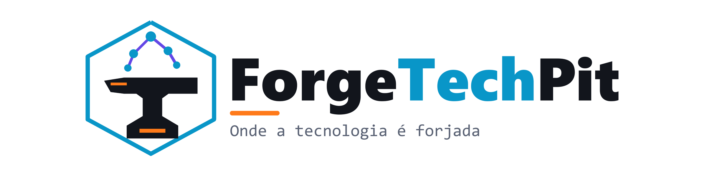

<a href="https://www.youtube.com/channel/UCYy1GZHC_Vwo_rJWimq4e6w">
  <picture>
    <source media="(prefers-color-scheme: dark)" srcset="https://raw.githubusercontent.com/forgetechpit/.github/main/profile/assets/logo-escuro.png">
    
  </picture>
</a>

**Onde a tecnologia é forjada · Where technology is forged**

[▶ YouTube](https://www.youtube.com/channel/UCYy1GZHC_Vwo_rJWimq4e6w) · [📖 Artigos / Articles](https://ceseidl.com.br) · [💼 LinkedIn](https://www.linkedin.com/in/carlosseidl)

---

## 🇧🇷 Português

**ForgeTechPit** é um canal de YouTube sobre **.NET, C#, arquitetura de software e IA aplicada**, em português do Brasil. Cada vídeo mostra um problema real: o código roda na tela, o erro acontece de verdade, um teste falha e depois passa com a correção.

**O que você encontra no canal**
- 🛠️ **Longos (10 a 12 min):** um tema por vídeo, do problema à solução funcionando.
- ⚡ **Shorts:** uma ideia, uma dica, em menos de um minuto.
- 🌱 **Série para iniciantes:** C#, .NET e Docker do zero, toda segunda-feira.
- 🤖 **IA na prática:** Claude Code, MCP, RAG em .NET, agentes.

**E aqui no GitHub?** Cada repositório é o código de um vídeo ou artigo. Clone, rode e compare com o que aparece na tela. Os exemplos usam **.NET 10**.

## 🇺🇸 English

**ForgeTechPit** is a YouTube channel about **.NET, C#, software architecture and applied AI**, in Brazilian Portuguese. Every video shows a real problem: the code runs on screen, the bug actually happens, and a test fails before it passes with the fix.

**What you will find on the channel**
- 🛠️ **Long videos (10 to 12 min):** one topic per video, from the problem to the working solution.
- ⚡ **Shorts:** one idea, one tip, under a minute.
- 🌱 **Beginner series:** C#, .NET and Docker from scratch, every Monday.
- 🤖 **Applied AI:** Claude Code, MCP, RAG in .NET, agents.

**And here on GitHub?** Each repository is the code behind a video or article. Clone it, run it and compare it with what you see on screen. Examples target **.NET 10**.

---

## 📚 Temas / Topics

`ASP.NET Core` · `Clean Architecture` · `Microsserviços / Microservices` · `Mensageria / Messaging` · `Resiliência / Resilience` · `Saga` · `Redis` · `Kubernetes` · `OpenTelemetry` · `JWT` · `C#` · `Claude Code` · `MCP` · `RAG`

## 🔗 Links

| | |
|---|---|
| ▶ YouTube | [ForgeTechPit](https://www.youtube.com/channel/UCYy1GZHC_Vwo_rJWimq4e6w) |
| 📖 Artigos PT/EN · Articles | [ceseidl.com.br](https://ceseidl.com.br) |
| 💼 LinkedIn | [Carlos Seidl](https://www.linkedin.com/in/carlosseidl) |
| 📦 Repositórios · Repositories | [github.com/forgetechpit](https://github.com/orgs/forgetechpit/repositories) |

> 🇧🇷 Gostou? Deixe o like, comente e se inscreva no canal.
> 🇺🇸 Enjoyed it? Like, comment and subscribe to the channel.

---

Por / By [Carlos Seidl](https://github.com/ceseidl) · Desenvolvedor backend .NET e Microsoft Certified Trainer · .NET backend developer and Microsoft Certified Trainer
